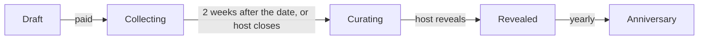
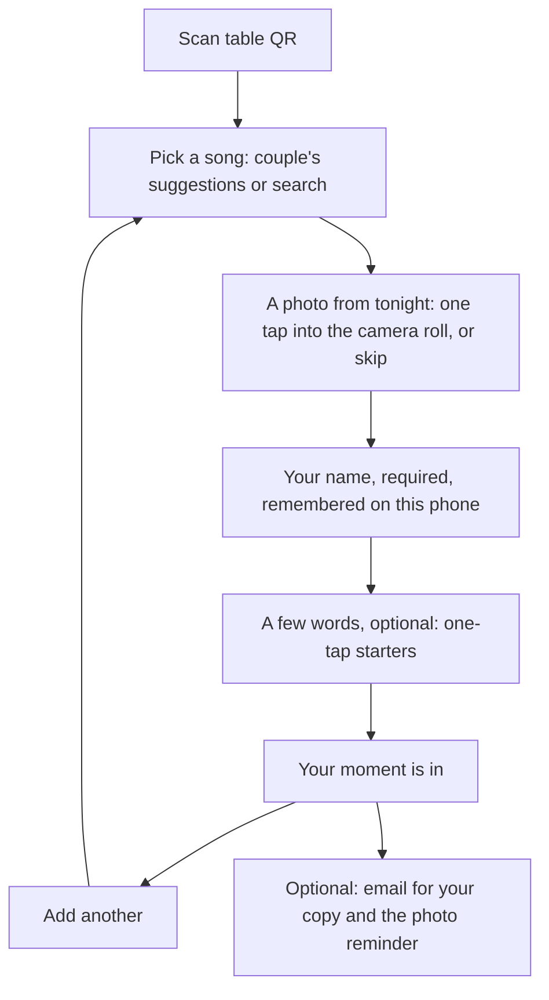

# Occasions: spec (weddings first)

Status: **signed off** (2026-10-20), open questions answered below. Decisions marked *decided*
are settled in conversation; everything else is a proposal. Open questions are
at the end. Update this file as decisions change, the way
`SOCIAL-ARCHITECTURE.md` is kept.

## What it is

A guest book that plays. At a wedding, every guest leaves the couple a
**moment**: a song, a photo from the night, and (if they like) a few words, with
their name. The couple keeps all of it as a page that plays the night back, and
can order it as things to hold: a tracklist print, thank-you cards, a book.

The song is the index; the moment is what people keep (*decided*). A montage
video captures the vibe; this captures each person, and the song brings it back
every time it comes on.

One engine, many occasions: weddings first, then group birthday gifts,
anniversaries, memorials, farewells. Nothing in the model is wedding-specific
except copy and templates.

## Principles

1. **Lazy guests win.** A guest finishes in about thirty seconds with a drink
   in one hand. No app, no account, no RSVP step (*decided*). Name is required,
   everything after the song is easy (*decided*).
2. **The moment is the product.** Every surface (capture, page, book) leads
   with photo + words + song, not a song list (*decided*).
3. **The couple never does admin.** Setup is minutes; after that, the product
   runs itself: reminders, closing, reveal, anniversaries.
4. **Josh is nowhere in the loop.** Payment, fulfilment, emails and print are
   automated. A small admin view exists for exceptions, not operations.
5. **Licensing is a hard line.** Songs play through the listener's own
   service (MusicKit JS for Apple Music subscribers, 30-second previews
   otherwise). Nothing is ever exported as audio or video with songs in it.
6. **Private by default.** The keepsake is unlisted (link only), photos live in
   a private bucket served by signed URLs, and the couple can hide anything.

## Roles

| Role | Who | Has an account? |
|---|---|---|
| Host | The couple (one or two people) | Yes, a Soundtracks account (web sign-in or the app) |
| Guest | Anyone with the table QR or link | No |
| Viewer | Anyone the couple sends the keepsake link to | No |
| Buyer | Whoever pays (usually a host; later, a gift-giver) | Email only at checkout |

## Lifecycle

- **Draft:** created, not paid. Guest link inactive. (Reserved couples from
  `/weddings` start here.)
- **Collecting:** opens on payment (so couples can test it), counts from the
  wedding date for the close. Guests add moments.
- **Curating:** closed to new entries. Host hides anything, reviews gallery
  fills, then reveals. Auto-reveals after 7 days if the host does nothing;
  what they hid stays hidden, and they can still hide more later.
  *Built 2026-10-26 (P1.6):* `occasions_tick()` runs every ten minutes on
  pg_cron, moving collecting books past their close to curating and curating
  books a week past it to revealed. Until it runs, the dashboard and the
  guest function already treat a book past its close as closed.
- **Revealed:** keepsake page live; downloads ready; orders open.
- **Anniversary:** each year on the date, one moment comes back by email (and
  push if the host has the app).

## Flows

### 1. Host setup (web first)

*Built 2026-10-22 (P1.3), payment stubbed.* `web/app/host/**` behind
`web/proxy.ts` (signed-in couples only; Supabase session cookies via
`@supabase/ssr`):

- **Sign in** at `/host/sign-in`: an emailed link (PKCE, landing on
  `/host/auth/callback`), or the Soundtracks password for app users. After
  sign-in, only `/host` paths are allowed as the return address.
- **Your weddings** (`/host`): the couple's occasions, and any `/weddings`
  reservation made with the same email, ready to set up.
- **Setup** (`/host/new`): names, date, guest count, city, time zone (the
  browser's by default), up to six suggested songs from Apple search, and
  the link (from the names, editable, checked as you type). Saved through
  `create_occasion_draft`, the only way to create an occasion (direct
  inserts are revoked). It picks a free link (the requested one, then with
  the month and year, then numbered; reserved words go straight to the
  dated form), links only a reservation whose email matches the caller's
  **confirmed** account email, and caps drafts at five. A table trigger keeps
  every edit to a real time zone and a date at most three years out.
- **Overview** (`/host/{id}`): a draft shows the $79 step; once open, the
  guest link with copy, the QR code, the song count and the closing date.
- **Table cards** (`/host/{id}/cards`): four to a letter page with cut lines
  and a QR code, printed from the browser (no PDF library).
- **Payment is a stand-in until Stripe:** the `occasion-host` edge function's
  `dev-activate` opens a draft only when its environment sets
  `ALLOW_DEV_PAYMENTS=true` (staging only), and the button only shows in
  builds with `NEXT_PUBLIC_DEV_PAYMENTS=true`. Stripe's webhook will call the
  same `activate_occasion()` (service role only): collecting until the end
  of the 14th day after the wedding, in the wedding's time zone.

Entry points: "Reserve your date" on `/weddings` (email arrives when setup
opens), the landing page, and later the app's second onboarding path
(*decided:* two onboarding flows, both available in the app).

1. **Your wedding:** both names as they should appear in print ("Sam &
   Priya"), date, city, rough guest count, time zone (from the city).
2. **Pick a few songs:** 3 to 6 suggestions that sit at the top of the guest
   list. Search is Apple's catalog (iTunes Search API, same as today's guest
   form). Optional; a sensible default set exists.
3. **Pay $79:** Stripe Checkout, on the web only (*decided*: no in-app
   purchase in v1; the app manages occasions bought on the web). Account is
   created or signed in here (email magic link), so nothing is lost.
4. **Your link:** a readable slug from the names (`sam-and-priya`), editable;
   on a clash we add the month and year (`sam-and-priya-june-2027`)
   (*decided*: readable).
5. **Your table cards:** a printable PDF (QR + "Pick a song for Sam & Priya"
   + the couple's names), the plain link (`soundtracks.app/for/sam-and-priya`)
   for the wedding website or a group text, and an upsell to have table cards
   printed and shipped.

Done. The host's dashboard shows a live count and the latest moments.

### 1b. The couple's dashboard (`/host/{id}`)

*Built 2026-10-24 (P1.4).* Once open, the overview is the dashboard:

- **Moments,** newest first: photo (signed URLs from the private bucket;
  gallery fills by their gallery path), song, words, guest name and time in
  the wedding's time zone. Hide and show per moment (writes
  `occasion_entries.hidden`; hidden ones fold behind "Show hidden (n)").
  The page refreshes itself every 30 seconds while the tab is visible and
  the book is collecting.
- **Share it:** the link, copy, QR, table cards, and two ready-made messages
  for the group chat: the ask (now) and the photo reminder (the week after).
- **Settings:** the "Just us" switch (`share_book_with_guests`), **Edit**
  (`/host/{id}/edit`, the setup form prefilled; the link is fixed once
  open), and **close early** (`close_occasion()`, host or co-host only,
  collecting only, can't be undone).
- The closing line names the last day ("through October 2"), not the
  midnight it closes at. Moving the date or time zone while collecting moves
  the close with it (the `occasions_validate` trigger); edits after closing,
  by hand or by time, never reopen it. Until P1.6's scheduled close flips the
  status, the dashboard treats a book past its close as closed.
- Since P1.5: "Most picked" under the count, a preview of the keepsake
  (`/host/{id}/book`), and the reveal (flow 5).

### 2. Guest capture (`/for/{slug}`, web, no account)

*Built 2026-10-21 (P1.2).* `web/app/for/[slug]` + `web/lib/occasionGuest.ts`,
the `occasion-entry` edge function (`create` / `update` with the edit token),
and the `get_occasion_for_guests` RPC, which returns only what a guest needs
and nothing for drafts.

- **Limits:** 15 an hour per phone, 300 an hour per address (from Cloudflare's
  `cf-connecting-ip`, which a client can't set; venue wifi shares one), 600 an
  hour per occasion from anyone, 3,000 visible entries per occasion (hiding
  spam frees room) and 6,000 in all. Bodies over 8 MB are refused before
  they're read. The address comes from Cloudflare's `cf-connecting-ip`,
  confirmed on staging: it matches `x-real-ip`, and Cloudflare rejects a
  request that tries to send its own.
- **No duplicates on retry:** the edit token is made on the guest's phone and
  is unique, so a retry after a lost response returns the entry it already
  made. Changing the moment starts a new token.
- **What hosts can read:** entries column by column. The address hash,
  device id, edit-token hash and guest email are server-only.
- **Follow-up:** a bot check (Cloudflare Turnstile) on create, once a site key
  exists, so a script inventing device ids can't fill a guest book.
- **Verified on staging (2026-10-21)** against the test wedding
  `/for/sam-and-priya-test` (host: staging E2E Two): a real entry with a
  photo (song details from Apple, a ~110 KB JPEG in the private bucket, only
  the token hash stored), the optional email, a song-only entry with a photo
  added later, a retry returning the same entry, and a forged token refused.

- **Song first**, then **a photo from tonight** asked second (*decided*), then
  **name**, then words with starters ("The night we met…", "You two in…",
  "Every summer…") (*decided*).
- Photos are compressed on the phone before upload (as `compressImage` does
  today) and stored privately.
- **Name:** labelled "Your name" with the placeholder "First and last", so
  most guests give a full name, but nothing is enforced. It prints exactly as
  typed ("Aunt Linda" and "Table 9" are fine) (*decided*). Remembered in
  `localStorage`, so a second moment is two taps.
- **Edit later from the same phone:** each entry gets a random `edit_token`
  kept in `localStorage`; reopening the link shows "Your moments" with "Add a
  photo" on any entry missing one.
- **Done screen:** "Your moment is in" with the moment as it will look, "Add
  another", and an optional email field: "Get the photo reminder and a link to
  the finished book." Email is the only way we can reach a guest; it is never
  required.
- Abuse: rate limit per device and IP, server-side validation, the host can
  hide anything. No profanity filter in v1.

### 3. The photo reminder (*decided*)

One reminder the week after the wedding, about photos only:

- **By email** to guests who left one: "Add your photos from Sam & Priya's
  wedding to the song you picked." The link carries their `edit_token`, so it
  opens straight to their entries.
- **For everyone else,** the host gets a ready-made message to paste into the
  wedding group chat (same link without a token; guests find their entries on
  the phone they used, or add a new moment).

Collection stays open two weeks after the date (*decided*).

### 4. Gallery fill (*decided: designed in from the start*)

Song-only entries get a photo from the couple's photographer.

1. The host adds the gallery: upload photos on the web (multi-select, or a
   zip). Linking Pic-Time, Pixieset or Google Photos comes later.
2. For each entry without a guest photo, we suggest the gallery photo whose
   EXIF capture time is closest to when that guest added their song, only
   for entries added during the event window (entries added the next day
   get no time match).
3. The host reviews a grid: accept, swap for another gallery photo, or leave
   it song-only. **Never auto-published.**
4. Later, maybe: opt-in face matching of the guest in the gallery.

Model support ships with the first release, even if matching ships second: a
gallery table and a per-entry photo source (`guest` | `gallery`).

### 5. Curate and reveal

- Host sees every entry (photo, song, words, name, time) in a grid and a list.
  Hide/unhide per entry. Duplicate songs group ("6 people picked
  September"), a feature (*decided*).
- "Reveal" publishes the keepsake and emails every guest who left an email:
  "Sam & Priya's guest book is ready." The couple also gets a ready-made
  message with the link for the group chat. The link is unlisted and shared
  with all guests by default; a "Just us" switch turns it off (*decided*).

*Built 2026-10-25 (P1.5), emails pending Resend.* Once the book is closed (by
hand or by time), the dashboard offers "Play it first" (the preview) and
**Reveal it** (`reveal_occasion()`: host or co-host, closed books only, once,
can't be undone). After the reveal it shows the keepsake link with a
ready-made group-chat message, or, with "Just us" on, a button for the two of
them. Guests who open the capture link again find a link to the book. The
email to guests who left one comes with the Resend batch; auto-reveal after
7 days with P1.6.

### 6. The keepsake page (`/for/{slug}/book?k={token}`, unlisted)

*Built 2026-10-25 (P1.5).* `web/components/Keepsake.tsx`, fed by the
`occasion-book` edge function for guests (the token checked in constant time,
revealed and shared only, every refusal the same 404; visible entries only;
signed photo URLs for six hours) and by the couple's own session for
`/host/{id}/book`, which always opens for them, "Just us" included. The page
sends no Referer (the token is the key) and isn't indexed.

- A night stage: each moment full-bleed (a song-only moment shows its cover
  over a wash of itself), song, words in Newsreader, name and time (just the
  time on the wedding night). The 30-second preview plays, then the next;
  previous/next, keyboard and lock-screen controls (Media Session). One audio
  element, so iOS keeps going after the first tap.
- Underneath, the liner notes: a tracklist of every moment in order with
  "Picked more than once", each row playing from there.
- Not yet: full playback and "Save to Apple Music" (MusicKit, third-party
  batch), a moment's own page.

*Downloads, built 2026-10-26 (P1.6), for the couple on the dashboard under
"Keep it":* every photo as a zip, made in their browser from the page's
signed URLs with fflate (stored, not recompressed; named "007 Alex Rivera -
Mr. Brightside.jpg" in the order the night went; any photo that fails is
counted, not dropped silently), and every note on a print page
(`/host/{id}/notes`) whose "Save as PDF" is the download, like the table
cards. Hidden moments are left out of both. Guests don't get downloads.

The spec as decided:

- **Plays like a radio show:** one moment at a time, full-bleed photo, song,
  words, name and time, in the order the night went. The song plays under
  it, then the next moment.
  - Apple Music subscribers: "Play full songs" signs in with MusicKit JS;
    songs start at a chosen point (the chorus when we can find it).
  - Everyone else: the 30-second preview, then the next moment.
- **Grid view** of everything, and a moment's own page to share.
- **Playlist:** "Save to Apple Music" (MusicKit JS creates it in the viewer's
  library). Spotify: search links per song only; creating playlists needs
  Spotify's extended quota (~250k MAU), so no export at our size.
- **Downloads:** every note as a PDF, every photo as a zip.
- Later, maybe: an AI host between songs reading guests' words verbatim (its
  voice is our own audio, mixed in the browser).

### 7. Things to hold (orders)

| Product | Price | Partner (proposed) | Notes |
|---|---|---|---|
| Tracklist print, 18×24 | $49 / framed $129 | Prodigi | The wedding as the back of a record sleeve; QR to the keepsake |
| Thank-you cards | $2.50 a card | Prodigi or Gelato | One per guest, their song and a QR; shipped to the couple with envelopes |
| Liner-notes book | $119 | Gelato or Lulu | Full page per moment; song-only picks on tracklist pages (*decided*) |
| The whole album | $279 | | Keepsake + framed print + book |

- Every order shows a **proof** rendered from real entries; the host approves
  before anything prints. Print files are generated server-side (HTML → PDF).
- Stripe Checkout on the web takes payment and shipping address; the partner
  API gets the order; partner webhooks drive "printed / shipped / delivered"
  emails.
- The book's layout is templated; AI may order, crop and title sections, but
  never rewrites a guest's words.

### 8. Anniversaries

On the date each year: "One year ago tonight, Mara picked September," with her
photo and words, a link into the keepsake, and push if a host has the app.

## Data model (built 2026-10-21)

Migration `20261021000000_occasions_foundation.sql`. New tables, separate from
personal albums. Albums stay as they are for app users; occasions replace guest
contributions (see "What happens to albums").

- **`occasions`**: host and optional co-host, names, date, city, time zone,
  guest estimate, readable `slug` (`/for/{slug}`, lowercase words joined by
  hyphens), `book_token` (unlisted keepsake link, 122 random bits),
  `status` (draft → collecting → curating → revealed; only a paid occasion
  can leave draft), `share_book_with_guests` (the "Just us" switch, default
  on), `suggested_songs` (0–6), `paid_at`, `stripe_checkout_id`, and a link
  back to the `wedding_reservations` row it came from.
- **`occasion_entries`**: one guest moment. Name (required, printed as
  typed), words, the song (Apple Music id, title, artist, album, artwork,
  preview), the photo (`photo_source` `guest` with a `photo_path`, or
  `gallery` with a `gallery_photo_id`, or none), `edit_token_hash` (the
  token itself only ever lives on the guest's phone and in their email),
  `device_id`, optional `guest_email`, `hidden`, and `created_at` (when they
  added it, which gallery matching uses).
- **`occasion_gallery_photos`**: the couple's photographer photos, with the
  EXIF `taken_at`. A composite foreign key means a gallery photo can only fill
  an entry of the same occasion; deleting one puts the entries it filled back
  to song-only.
- **Orders** (`occasion_orders`) arrive with P2 in their own migration.

Who can do what:

- **Hosts** (host or co-host, `is_occasion_host()`) read their occasions,
  create drafts, edit the details (names, date, city, time zone, guest
  estimate, suggested songs, "Just us"), hide entries, fill entries from the
  gallery, and manage the gallery. They **cannot** touch `status`, `paid_at`,
  Stripe ids, `book_token` or `slug`, or a guest's words and photo: column
  grants enforce that, not just policies. Only an unpaid draft can be deleted
  by its host.
- **Guests** never get a session. Their entries and photos go through the
  service role (an edge function that validates and rate-limits).
- **Nobody anonymous** can read anything. The keepsake page is
  server-rendered and checks `book_token` with the service role.
- **Storage:** a new **private** `occasion-photos` bucket
  (`{occasion_id}/entries/{id}.jpg` for guests, `{occasion_id}/gallery/{id}.jpg`
  for hosts), served by short-lived signed URLs. Hosts can read their
  occasion's photos and upload or delete only gallery photos. Deleting an
  account removes the photos of every occasion it hosted
  (`delete-account`).
- Tested against a local Postgres with Supabase's roles stubbed: 29 checks
  covering hosts, other users, anon and the bucket.

Reservations (`wedding_reservations`) convert to a draft occasion when setup
opens; the email is the bridge.

## Automation (Josh out of the loop)

- **Email (Resend):** host setup confirmation, collection open, a short daily
  digest during collection (count + a few new moments), close, reveal ready;
  guest copy, photo reminder, reveal; order status; anniversaries.
- **Scheduled jobs (Supabase cron):** close collection and auto-reveal (built,
  `occasions-tick`); the photo reminder and anniversaries come with Resend.
- **Webhooks:** Stripe (paid), print partners (shipped).
- **Admin view:** a protected page listing occasions, failed jobs and stuck
  orders, with resend and refund buttons. For exceptions only.

## What happens to albums and guest contributions

- Production has 10 albums, none with guest contributions turned on, and 5
  guest moments, so there is nothing to migrate in practice.
- **Proposed:** albums stay a journal feature for app users (personal and
  shared). Guest contributions (`/c/{code}/contribute`, the guest auth user,
  `events_tier_unlocked`) are frozen: existing pages keep working read-only,
  new guest collecting happens only in occasions, and the old path is removed
  in a later cleanup.

## Phases

| Phase | What ships | Goal |
|---|---|---|
| **P1: sell it** (first release, no free pilot, *decided*) | Tables, private bucket, guest capture (song → photo → name → words), host setup on the web with Stripe ($79), readable links, reservations → draft occasions, host dashboard (count, list, hide), photo reminder + guest and host emails, edit-later, keepsake page (previews, Apple Music full playback, playlist save), downloads (PDF + zip), auto close/reveal | First paid weddings, spring 2027 |
| **P2: the gaps and the print** | Gallery upload + time-matched fill with host review, tracklist print and thank-you cards with proofs (Prodigi) | First physical orders |
| **P3: the book and the app** | Liner-notes book (layout + proofs), anniversaries, host experience in the app + the second onboarding path | The full product |
| Later | Other occasions, gift-giver checkout, AI host, live wall at the reception, gallery links, face matching | |

## Answered (2026-10-20)

1. **Where hosts pay:** web only (Stripe) for v1. The app manages occasions
   bought on the web; no in-app purchase.
2. **Free pilot:** no. The first release charges.
3. **Who sees the keepsake:** an unlisted link shared with all guests by
   default, with a "Just us" switch.
4. **Reaching guests:** both. An optional email on the done screen ("Get the
   photo reminder and the finished book"), and a ready-made message the couple
   pastes into the group chat for everyone else. Guests have no account, so
   these are the only two ways to reach them.
5. **The link:** readable, `soundtracks.app/for/sam-and-priya`. Guest links
   are meant to be shared (they're on the tables), so guessable is fine; the
   keepsake keeps its own unlisted token.
6. **Names:** the field suggests "First and last" but accepts anything, and
   prints as typed.
