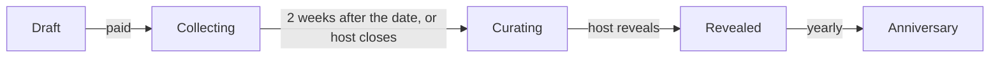
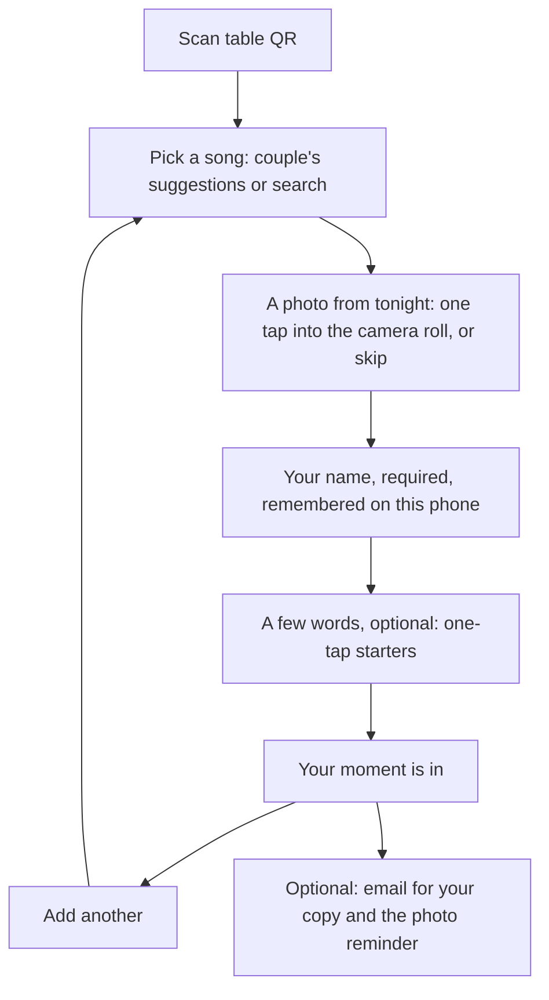

# Occasions: spec (weddings first)

Status: **signed off** (2026-10-20), open questions answered below. Decisions marked *decided*
are settled in conversation; everything else is a proposal. Open questions are
at the end. Update this file as decisions change, the way
`SOCIAL-ARCHITECTURE.md` is kept.

## What it is

A guest book that plays. At a wedding, every guest leaves the couple a
**moment**: a song, a photo from the night, and (if they like) a few words, with
their name. The couple keeps all of it as a page that plays the night back, and
can order it as things to hold: a tracklist print, thank-you cards, a book.

The song is the index; the moment is what people keep (*decided*). A montage
video captures the vibe; this captures each person, and the song brings it back
every time it comes on.

One engine, many occasions: weddings first, then group birthday gifts,
anniversaries, memorials, farewells. Nothing in the model is wedding-specific
except copy and templates.

## Principles

1. **Lazy guests win.** A guest finishes in about thirty seconds with a drink
   in one hand. No app, no account, no RSVP step (*decided*). Name is required,
   everything after the song is easy (*decided*).
2. **The moment is the product.** Every surface (capture, page, book) leads
   with photo + words + song, not a song list (*decided*).
3. **The couple never does admin.** Setup is minutes; after that, the product
   runs itself: reminders, closing, reveal, anniversaries.
4. **Josh is nowhere in the loop.** Payment, fulfilment, emails and print are
   automated. A small admin view exists for exceptions, not operations.
5. **Licensing is a hard line.** Songs play through the listener's own
   service (MusicKit JS for Apple Music subscribers, 30-second previews
   otherwise). Nothing is ever exported as audio or video with songs in it.
6. **Private by default.** The keepsake is unlisted (link only), photos live in
   a private bucket served by signed URLs, and the couple can hide anything.

## Roles

| Role | Who | Has an account? |
|---|---|---|
| Host | The couple (one or two people) | Yes, a Soundtracks account (web sign-in or the app) |
| Guest | Anyone with the table QR or link | No |
| Viewer | Anyone the couple sends the keepsake link to | No |
| Buyer | Whoever pays (usually a host; later, a gift-giver) | Email only at checkout |

## Lifecycle



- **Draft:** created, not paid. Guest link inactive. (Reserved couples from
  `/weddings` start here.)
- **Collecting:** opens on payment (so couples can test it), counts from the
  wedding date for the close. Guests add moments.
- **Curating:** closed to new entries. Host hides anything, reviews gallery
  fills, then reveals. Auto-reveals after 7 days if the host does nothing,
  with everything visible (the host can still hide later).
- **Revealed:** keepsake page live; downloads ready; orders open.
- **Anniversary:** each year on the date, one moment comes back by email (and
  push if the host has the app).

## Flows

### 1. Host setup (web first)

Entry points: "Reserve your date" on `/weddings` (email arrives when setup
opens), the landing page, and later the app's second onboarding path
(*decided:* two onboarding flows, both available in the app).

1. **Your wedding:** both names as they should appear in print ("Sam &
   Priya"), date, city, rough guest count, time zone (from the city).
2. **Pick a few songs:** 3 to 6 suggestions that sit at the top of the guest
   list. Search is Apple's catalog (iTunes Search API, same as today's guest
   form). Optional; a sensible default set exists.
3. **Pay $79:** Stripe Checkout, on the web only (*decided*: no in-app
   purchase in v1; the app manages occasions bought on the web). Account is
   created or signed in here (email magic link), so nothing is lost.
4. **Your link:** a readable slug from the names (`sam-and-priya`), editable;
   on a clash we add the month and year (`sam-and-priya-june-2027`)
   (*decided*: readable).
5. **Your table cards:** a printable PDF (QR + "Pick a song for Sam & Priya"
   + the couple's names), the plain link (`soundtracks.app/for/sam-and-priya`)
   for the wedding website or a group text, and an upsell to have table cards
   printed and shipped.

Done. The host's dashboard shows a live count and the latest moments.

### 2. Guest capture (`/for/{slug}`, web, no account)



- **Song first**, then **a photo from tonight** asked second (*decided*), then
  **name**, then words with starters ("The night we met…", "You two in…",
  "Every summer…") (*decided*).
- Photos are compressed on the phone before upload (as `compressImage` does
  today) and stored privately.
- **Name:** labelled "Your name" with the placeholder "First and last", so
  most guests give a full name, but nothing is enforced. It prints exactly as
  typed ("Aunt Linda" and "Table 9" are fine) (*decided*). Remembered in
  `localStorage`, so a second moment is two taps.
- **Edit later from the same phone:** each entry gets a random `edit_token`
  kept in `localStorage`; reopening the link shows "Your moments" with "Add a
  photo" on any entry missing one.
- **Done screen:** "Your moment is in" with the moment as it will look, "Add
  another", and an optional email field: "Get the photo reminder and a link to
  the finished book." Email is the only way we can reach a guest; it is never
  required.
- Abuse: rate limit per device and IP, server-side validation, the host can
  hide anything. No profanity filter in v1.

### 3. The photo reminder (*decided*)

One reminder the week after the wedding, about photos only:

- **By email** to guests who left one: "Add your photos from Sam & Priya's
  wedding to the song you picked." The link carries their `edit_token`, so it
  opens straight to their entries.
- **For everyone else,** the host gets a ready-made message to paste into the
  wedding group chat (same link without a token; guests find their entries on
  the phone they used, or add a new moment).

Collection stays open two weeks after the date (*decided*).

### 4. Gallery fill (*decided: designed in from the start*)

Song-only entries get a photo from the couple's photographer.

1. The host adds the gallery: upload photos on the web (multi-select, or a
   zip). Linking Pic-Time, Pixieset or Google Photos comes later.
2. For each entry without a guest photo, we suggest the gallery photo whose
   EXIF capture time is closest to when that guest added their song, only
   for entries added during the event window (entries added the next day
   get no time match).
3. The host reviews a grid: accept, swap for another gallery photo, or leave
   it song-only. **Never auto-published.**
4. Later, maybe: opt-in face matching of the guest in the gallery.

Model support ships with the first release, even if matching ships second: a
gallery table and a per-entry photo source (`guest` | `gallery`).

### 5. Curate and reveal

- Host sees every entry (photo, song, words, name, time) in a grid and a list.
  Hide/unhide per entry. Duplicate songs group ("6 people picked
  September"), a feature (*decided*).
- "Reveal" publishes the keepsake and emails every guest who left an email:
  "Sam & Priya's guest book is ready." The couple also gets a ready-made
  message with the link for the group chat. The link is unlisted and shared
  with all guests by default; a "Just us" switch turns it off (*decided*).

### 6. The keepsake page (`/for/{slug}/book?k={token}`, unlisted)

- **Plays like a radio show:** one moment at a time, full-bleed photo, song,
  words, name and time, in the order the night went. The song plays under
  it, then the next moment.
  - Apple Music subscribers: "Play full songs" signs in with MusicKit JS;
    songs start at a chosen point (the chorus when we can find it).
  - Everyone else: the 30-second preview, then the next moment.
- **Grid view** of everything, and a moment's own page to share.
- **Playlist:** "Save to Apple Music" (MusicKit JS creates it in the viewer's
  library). Spotify: search links per song only; creating playlists needs
  Spotify's extended quota (~250k MAU), so no export at our size.
- **Downloads:** every note as a PDF, every photo as a zip.
- Later, maybe: an AI host between songs reading guests' words verbatim (its
  voice is our own audio, mixed in the browser).

### 7. Things to hold (orders)

| Product | Price | Partner (proposed) | Notes |
|---|---|---|---|
| Tracklist print, 18×24 | $49 / framed $129 | Prodigi | The wedding as the back of a record sleeve; QR to the keepsake |
| Thank-you cards | $2.50 a card | Prodigi or Gelato | One per guest, their song and a QR; shipped to the couple with envelopes |
| Liner-notes book | $119 | Gelato or Lulu | Full page per moment; song-only picks on tracklist pages (*decided*) |
| The whole album | $279 | | Keepsake + framed print + book |

- Every order shows a **proof** rendered from real entries; the host approves
  before anything prints. Print files are generated server-side (HTML → PDF).
- Stripe Checkout on the web takes payment and shipping address; the partner
  API gets the order; partner webhooks drive "printed / shipped / delivered"
  emails.
- The book's layout is templated; AI may order, crop and title sections, but
  never rewrites a guest's words.

### 8. Anniversaries

On the date each year: "One year ago tonight, Mara picked September," with her
photo and words, a link into the keepsake, and push if a host has the app.

## Data model (proposed)

New tables, separate from personal albums. Albums stay as they are for app
users; occasions replace guest contributions (*proposed*, see "What happens to
albums").

```sql
occasions (
  id uuid pk, kind text default 'wedding',
  host_user_id uuid references auth.users, co_host_user_id uuid null,
  names text, event_date date, city text, time_zone text, guest_estimate int,
  slug text unique,            -- /for/{slug}, the guest link (readable)
  book_token text unique,      -- unlisted keepsake link
  status text,                 -- draft | collecting | curating | revealed
  collect_closes_at timestamptz, revealed_at timestamptz,
  suggested_songs jsonb,       -- [{appleMusicId, title, artist, artworkUrl, previewUrl}]
  paid_at timestamptz, stripe_checkout_id text,
  created_at timestamptz
)

occasion_entries (
  id uuid pk, occasion_id uuid references occasions on delete cascade,
  guest_name text not null, words text null,
  song_apple_id text, song_title text, song_artist text,
  song_artwork_url text, song_preview_url text,
  photo_path text null, photo_source text null,   -- 'guest' | 'gallery'
  gallery_photo_id uuid null,
  edit_token_hash text, device_id text, guest_email text null,
  hidden boolean default false,
  created_at timestamptz, updated_at timestamptz
)

occasion_gallery_photos (
  id uuid pk, occasion_id uuid, path text, taken_at timestamptz null,
  width int, height int, created_at timestamptz
)

occasion_orders (
  id uuid pk, occasion_id uuid, product text, quantity int, amount_cents int,
  stripe_session_id text, partner text, partner_order_id text,
  status text,                -- proof | paid | submitted | shipped | delivered
  proof_path text, created_at timestamptz
)
```

- **Writes from guests** go through one edge function (service role) that
  validates, rate-limits and hashes the edit token. Guests never get a
  Supabase session; the guest-auth-user-per-album trick goes away.
- **RLS:** hosts read/write their own occasions and entries. No anon reads; the
  keepsake page is server-rendered and checks `book_token`.
- **Storage:** a new **private** `occasion-photos` bucket, served by short-lived
  signed URLs. Deleting an entry or occasion deletes its objects (the existing
  rule for moment photos).
- Reservations (`wedding_reservations`) convert to a draft occasion when setup
  opens; the email is the bridge.

## Automation (Josh out of the loop)

- **Email (Resend):** host setup confirmation, collection open, a short daily
  digest during collection (count + a few new moments), close, reveal ready;
  guest copy, photo reminder, reveal; order status; anniversaries.
- **Scheduled jobs (Supabase cron):** close collection, auto-reveal, the photo
  reminder, anniversaries.
- **Webhooks:** Stripe (paid), print partners (shipped).
- **Admin view:** a protected page listing occasions, failed jobs and stuck
  orders, with resend and refund buttons. For exceptions only.

## What happens to albums and guest contributions

- Production has 10 albums, none with guest contributions turned on, and 5
  guest moments, so there is nothing to migrate in practice.
- **Proposed:** albums stay a journal feature for app users (personal and
  shared). Guest contributions (`/c/{code}/contribute`, the guest auth user,
  `events_tier_unlocked`) are frozen: existing pages keep working read-only,
  new guest collecting happens only in occasions, and the old path is removed
  in a later cleanup.

## Phases

| Phase | What ships | Goal |
|---|---|---|
| **P1: sell it** (first release, no free pilot, *decided*) | Tables, private bucket, guest capture (song → photo → name → words), host setup on the web with Stripe ($79), readable links, reservations → draft occasions, host dashboard (count, list, hide), photo reminder + guest and host emails, edit-later, keepsake page (previews, Apple Music full playback, playlist save), downloads (PDF + zip), auto close/reveal | First paid weddings, spring 2027 |
| **P2: the gaps and the print** | Gallery upload + time-matched fill with host review, tracklist print and thank-you cards with proofs (Prodigi) | First physical orders |
| **P3: the book and the app** | Liner-notes book (layout + proofs), anniversaries, host experience in the app + the second onboarding path | The full product |
| Later | Other occasions, gift-giver checkout, AI host, live wall at the reception, gallery links, face matching | |

## Answered (2026-10-20)

1. **Where hosts pay:** web only (Stripe) for v1. The app manages occasions
   bought on the web; no in-app purchase.
2. **Free pilot:** no. The first release charges.
3. **Who sees the keepsake:** an unlisted link shared with all guests by
   default, with a "Just us" switch.
4. **Reaching guests:** both. An optional email on the done screen ("Get the
   photo reminder and the finished book"), and a ready-made message the couple
   pastes into the group chat for everyone else. Guests have no account, so
   these are the only two ways to reach them.
5. **The link:** readable, `soundtracks.app/for/sam-and-priya`. Guest links
   are meant to be shared (they're on the tables), so guessable is fine; the
   keepsake keeps its own unlisted token.
6. **Names:** the field suggests "First and last" but accepts anything, and
   prints as typed.
